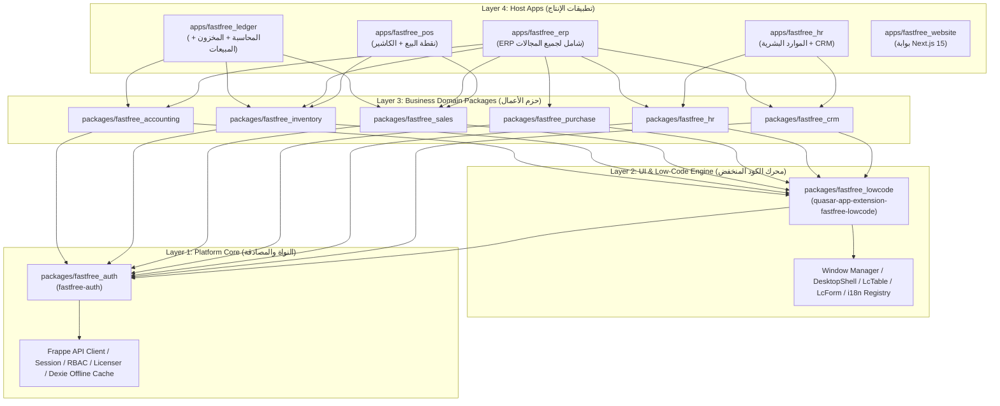

# FastFree Architecture Deep Dive — دليل المعمارية التفصيلي

يوثق هذا المرجع الهيكل المعماري البرمجي لمنصة **FastFree** بالتفصيل، وكيفية ارتباط حزم العمل (Domain Packages) بنواة النظام (Platform Core) ومحرك الكود المنخفض (Low-Code Engine) وتطبيقات الواجهة (Host Apps).

---

## 1. المعمارية الطبقية رباعية المستويات (4-Layered Architecture)

تم تصميم منصة FastFree بنظام طبقي صارم يفصل بين الأساس المشترك (Platform Foundation)، ومحرك الواجهات الديناميكية، وحزم نطاقات الأعمال، والتطبيقات القابلة للنشر:



---

## 2. تفصيل الطبقات ومسؤولياتها

### الطبقة الأولى: Platform Core (`packages/fastfree_auth`)
- **الاسم الحزمي**: `fastfree-auth`
- **الوظيفة**:
  - تمثل نقطة الاتصال المركزية مع خادم Frappe الخلفي عبر مكتبة `frappe-js-sdk` وعميل API الموحد `api.service.ts`.
  - إدارة الجلسات والمصادقة (Login, Logout, Session Refresh, Password Reset).
  - نظام الصلاحيات الموحد (RBAC) عبر `permission.service.ts` واستعلام `can(action, doctype)`.
  - التحقق من التراخيص وتخزين الإعدادات محلياً باستخدام `Dexie` (IndexedDB).
  - Realtime WebSocket Singleton عبر `socket.io-client` لضمان عدم فتح اتصالات متعددة مكررة.

### الطبقة الثانية: Low-Code Engine (`packages/fastfree_lowcode`)
- **الاسم الحزمي**: `quasar-app-extension-fastfree-lowcode`
- **الوظيفة**:
  - توفير واجهة سطح المكتب متعددة النوافذ (`DesktopShell`, `WindowPanel`, `DesktopDock`).
  - الجداول التفاعلية الديناميكية (`DynamicTable`, `BaseList`) والنماذج (`DynamicForm`, `BaseFormFields`).
  - سجل مركزي ديناميكي للنوافذ والمجموعات والترجمات:
    - `registerScreen(type, { component, label, icon, groupId })`
    - `registerGroup(name, icon)`
    - `registerGroupPage(groupName, page)`
    - `registerMessages(namespace, en, ar)`
  - شاشات النظام المدمجة: شاشة البداية (`LcSplashScreen`)، فحص الاتصال بالخادم (`LcConnectionScreen`)، سجل الأخطاء (`LcErrorLogScreen`)، إعدادات السمة (`LcThemeScreen`)، ومحرر الترجمات المباشر (`LcTranslationEditorScreen`).

### الطبقة الثالثة: Business Domains (`packages/fastfree_*`)
تتضمن ست حزم رئيسية تمثل نطاقات أعمال ERP:
1. `fastfree_accounting`: شجرة الحسابات، قيود اليومية، سندات القبض والدفع، ميزان المراجعة، مراكز التكلفة، السنوات المالية، والتقارير المالية.
2. `fastfree_inventory`: دليل الأصناف والمنتجات، المجموعات، المستودعات، حركات النقل الجردي (Stock Entry)، ومستويات المخزون.
3. `fastfree_sales`: دورة المبيعات (العملاء، عروض الأسعار Quotations، أوامر البيع Sales Orders، فواتير المبيعات Invoices، سندات التسليم Delivery Notes).
4. `fastfree_purchase`: دورة المشتريات (الموردين، طلبات الشراء Purchase Orders، أذون الاستلام Receipts، فواتير الشراء Invoices).
5. `fastfree_hr`: الموارد البشرية (الموظفون، الأقسام، المسميات الوظيفية، سجل الحضور، الإجازات، مسيرات الرواتب Payroll، قسائم الرواتب).
6. `fastfree_crm`: علاقات العملاء (العملاء المحتملون Leads، الفرص البيعية Opportunities، جهات الاتصال Contacts، الحملات Campaigns).

حزم إضافية:
- `fastfree_update`: امتداد كوازار للتحقق من التحديثات وتحديثات OTA.
- `fastfree_vpn`: تكامل شبكة WireGuard VPN مع تطبيقات الهاتف عبر Capacitor.

### الطبقة الرابعة: Host Applications (`apps/*`)
تطبيقات الإنتاج التي تجمّع الحزم عبر Quasar Boot Files:
- `apps/fastfree_ledger`: تطبيق الدفتر والمحاسبة والمخزون، وهو التطبيق المرجعي القياسي لاختبارات النوع والجودة (Quality Gate Host).
- `apps/fastfree_erp`: التطبيق الشامل الذي يجمع كافة حزم النظام.
- `apps/fastfree_pos`: تطبيق الكاشير ونقاط البيع للمتاجر السريعة.
- `apps/fastfree_hr`: تطبيق متخصص للموارد البشرية وإدارة الموظفين والعملاء.
- `apps/fastfree_website`: الموقع التعريفي والبوابة التسويقية المبنية على Next.js 15.
- `apps/fastfree_backend`: حزمة تطبيقات Frappe الخلفية وتهيئة حاويات الإنتاج.
- `apps/fastfree_os`: توزيعة نظام NixOS المتكاملة للنشر على خوادم VPS وأجهزة Hyper-V والأجهزة المحلية.
- `apps/fastfree_setup`: حزمة أدوات تثبيت ويندوز عبر Inno Setup.

---

## 3. ترتيب التهيئة الإلزامي (Strict Boot Order)

يتم تشغيل تهيئة التطبيق في Quasar عبر ملف `quasar.config.ts` في قسم `boot`. يجب الحفاظ على الترتيب التالي بدقة لمنع حدوث Race Conditions أو فقدان في تسجيل الترجمات:

```text
1. fastfree-auth-init        → تهيئة عميل API، تحميل الجلسة والتحقق من التوكن
2. fastfree-accounting-init  → تسجيل شاشات ومجموعات وترجمات المحاسبة
3. fastfree-inventory-init   → تسجيل شاشات ومجموعات وترجمات المخزون
4. fastfree-sales-init       → تسجيل شاشات ومجموعات وترجمات المبيعات
5. fastfree-purchase-init    → تسجيل شاشات ومجموعات وترجمات المشتريات
6. fastfree-hr-init          → تسجيل شاشات ومجموعات وترجمات الموارد البشرية
7. fastfree-crm-init         → تسجيل شاشات ومجموعات وترجمات CRM
8. i18n                      → تجميع وتفعيل نصوص اللغات (يجب أن يعمل بعد تسجيل كل الحزم)
9. register-service-worker   → تسجيل عمال الخدمة للتخزين دون اتصال PWA
10. fastfree-update-init     → فحص وإدارة التحديثات
```

---

## 4. ربط مسارات TypeScript و Vite في الـ Monorepo

في ملف `quasar.config.ts`، يتم ربط مسارات الحزم المشتركة مباشرة عبر:
```typescript
extendTsConfig(tsConfig) {
  tsConfig.compilerOptions.paths['fastfree-auth'] = ['../../../packages/fastfree_auth/src/index.ts']
  tsConfig.compilerOptions.paths['fastfree-accounting'] = ['../../../packages/fastfree_accounting/src/index.ts']
  tsConfig.compilerOptions.paths['quasar-app-extension-fastfree-lowcode/src/runtime'] = ['../../../packages/fastfree_lowcode/src/runtime/index.ts']
  // ... بقية الحزم
}
```

وفي قسم Vite Server File System:
```typescript
extendViteConf(viteConf) {
  viteConf.server.fs.allow = [
    appRoot,
    path.join(monorepoRoot, 'node_modules'),
    path.join(monorepoRoot, 'packages', 'fastfree_lowcode'),
    path.join(monorepoRoot, 'packages', 'fastfree_auth'),
    path.join(monorepoRoot, 'packages', 'fastfree_accounting'),
    path.join(monorepoRoot, 'packages', 'fastfree_inventory'),
    // ...
  ]
}
```
هذا الإعداد يتيح استخدام تقنية Hot Module Replacement (HMR) عبر الحزم المتعددة دون الحاجة لإعادة بناء (Build) الحزم عند تعديل كودها أثناء التطوير.
