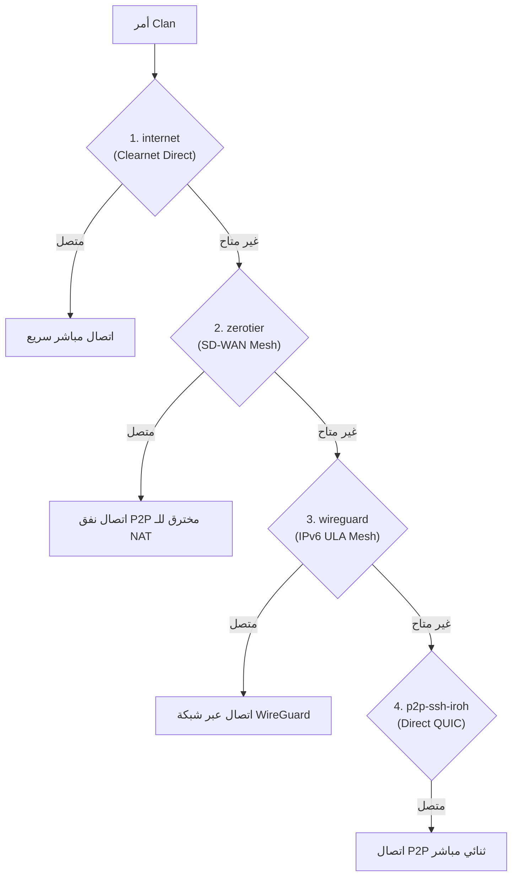

# FastFree Flox, NixOS & Clan 26.05 Infrastructure Guide

يوثق هذا الدليل بيئة التطوير الهرمسية (Hermetic Dev Environment) عبر **Flox**، ونظام تشغيل ونشر البنية التحتية للمخدمات والأجهزة عبر **NixOS** وإطار عمل **Clan** (`clan.lol` إصدار 26.05).

---

## 1. أداة Flox — بيئة التطوير المعزولة والموحدة

تستخدم FastFree أداة **Flox** (المبنية على محرك Nix) لضمان توفر نفس الأدوات والتبعيات الدقيقة على جميع أجهزة المطورين وخوادم البناء دون أي تعارض مع نظام التشغيل الأصلي للمطور.

### ملف التهيئة: `.flox/env/manifest.toml`
تتضمن البيئة الأدوات الأساسية:
- `nodejs_22`: بيئة تشغيل جافاسكريبت الموحدة.
- `pnpm`: مدير حزم الـ Monorepo.
- `python312`: بيئة بايثون لسكربتات الأتمتة والنشر.
- `jdk21`: حزمة جافا لبناء تطبيقات أندرويد عبر Gradle.
- `git` و `gh`: للتحكم في الإصدارات وواجهة سطر أوامر GitHub.

### أوامر العمل اليومية مع Flox:
```bash
# 1. الدخول في بيئة Flox تفاعلية
flox activate

# 2. تنفيذ أمر مباشر داخل بيئة Flox دون تبديل الشل
flox activate -- pnpm install --no-frozen-lockfile --ignore-scripts
flox activate -- pnpm --filter fastfree_ledger dev

# 3. التحقق من مسارات الأدوات وإصداراتها داخل البيئة
flox activate -- node --version
flox activate -- pnpm --version
```

---

## 2. بنية NixOS ونظام إدارة الأجهزة عبر Clan (`apps/fastfree_os`)

نظام FastFree OS مبني كـ Nix Flake متكامل يستخدم إطار عمل **Clan** (`clan.lol` إصدار 26.05) لإدارة الأجهزة والشبكات والنسخ الاحتياطي وإدارة الأسرار.

### ملف مدخل المونوريبو الجذر: `flake.nix`
يعمل الملف الجذري كـ Clan Entry Shim ليعيد تصدير كافة مخرجات `apps/fastfree_os`:
```nix
inputs.fastfree-os.url = "path:./apps/fastfree_os";
outputs = { fastfree-os, ... }: {
  inherit (fastfree-os) clan clanInternals nixosConfigurations checks devShells packages;
};
```

---

## 3. مصفوفة الأجهزة وأنواع النشر (Machines & Deployment Types)

يحدد ملف `apps/fastfree_os/clan.nix` ثلاثة أجهزة مستهدفة:

| الجهاز | النوع | طريقة النشر | الوصف والمسؤولية |
|---|---|---|---|
| **client1** | `hyperv` | بناء صورة VHDX مضغوطة بـ 7z | خادم افتراضي يعمل على Windows Hyper-V Gen 2 (Secure Boot مُعطل) |
| **client2** | `vps` | نشر SSH تلقائي (`10-client2.yaml`) | خادم الإنتاج السحابي العام (`fastfree.cloud`) المستضيف لـ Frappe والـ SPAs |
| **client3** | `local` | إعادة بناء موضعية (`sudo nixos-rebuild`) | جهاز التطوير المكتبي المحلي — محمي من المسح أو النشر عن بُعد |

```
┌─────────────────────────────────────────────────────────────┐
│                    3 Deployment Targets                     │
├─────────────────────────────────────────────────────────────┤
│                                                             │
│   client1 (Hyper-V)      client2 (VPS)     client3 (Local)  │
│          │                     │                  │         │
│          ▼                     ▼                  ▼         │
│     nix build             SSH Deploy        Local Switch    │
│   (.#packages.client1)  (clan machines)   (nixos-rebuild)   │
│          │                     │                  │         │
│          ▼                     ▼                  ▼         │
│      VHDX (7z)           Production Host    Developer Host  │
│   Gen2 (No SecBoot)    (fastfree.cloud)   (Preserves State) │
└─────────────────────────────────────────────────────────────┘
```

---

## 4. شبكات Clan المتعددة (Multi-Transport Architecture) في إصدار 26.05

في إصدار 26.05، يقدم Clan بنية شبكات متطورة تعتمد على **أولويات النقل والتبديل التلقائي (Transport Priority & Failover)**. عند كتابة `clan ssh client2` أو `clan machines update client2`، يتم اختبار المسارات تلقائياً:



### 1. خدمة `internet` (Clearnet Transport):
- المسار: `services/official/internet`
- التوصيف الرسمي للوصول المباشر عبر الإنترنت العام لجهاز VPS.
- تدعم الدومين، الـ Port، المستخدم، وخوادم العبور (Jumphosts):
```nix
inventory.instances.internet = {
  roles.default.machines."client2".settings = {
    host = "fastfree.cloud";
    port = 22;
    user = "root";
    jumphosts = [];
  };
};
```

### 2. خدمة `wireguard` (Kernel IPv6 ULA Mesh):
- المسار: `services/official/wireguard`
- شبكة نواة عالية الأداء تعتمد على عناوين IPv6 الخاصة (`fd00::/8`).
- تم تكوينها على المنفذ `51821` لتفادي التعارض مع شبكة `wg0` القديمة (`51820`).
- `client2` يعمل كـ `controller` بنطاق `fastfree.cloud`، بينما `client1` و `client3` يعملان كـ `peer`.

### 3. خدمة `zerotier` (L2/L3 Mesh with Self-Hosted Controller):
- المسار: `services/official/zerotier`
- تخترق جدران الحماية المعقدة (Symmetric NAT) تلقائياً.
- استضافة ذاتية كاملة: `client2` يمكنه العمل كـ `controller` وكـ `moon` برقم منفذ `9993` وثابت `stableEndpoints`.
- ميزة 26.05: **التعرف التلقائي على عنوان الـ IP** دون الحاجة لكتابته يدوياً في الملفات.

---

## 5. كتالوج خدمات Clan الرسمية في FastFree (Official Services)

| الخدمة | المسار في Clan | الفئة | الوظيفة في FastFree |
|---|---|---|---|
| **`wireguard`** | `services/official/wireguard` | شبكات | شبكة الاتصال الداخلي المشفرة بين أجهزة الأسطول |
| **`internet`** | `services/official/internet` | شبكات | نقطة الدخول العامة الصريحة للـ VPS |
| **`zerotier`** | `services/official/zerotier` | شبكات | الشبكة الاحتياطية لاختراق الـ NAT والأجهزة المتنقلة |
| **`garage`** | `services/official/garage` | تخزين | مخزن كائنات S3 موزع ومستقل لمزامنة الملفات وقواعد البيانات |
| **`borgbackup`** | `services/official/borgbackup` | نسخ احتياطي | مستودع مركزي على `client2` ونسخ مشفر ومحلي لـ `client3` |
| **`monitoring`** | `services/official/monitoring` | مراقبة | مجمع Grafana و Loki و Mimir لمراقبة الأداء والسجلات |
| **`ncps`** | `services/official/ncps` | كاش وبناء | خادم كاش لحزم NixOS يسرع بناء وتحديث الأنظمة بنسبة 80% |
| **`trusted-nix-caches`** | `services/official/trusted-nix-caches` | كاش | ربط الأسطول بمستودعات الكاش الموثوقة لتسريع التثبيت |
| **`emergency-access`** | `services/official/emergency-access` | حماية | كلمة سر طارئة مشفرة في `initrd` لإنقاذ النظام عند فشل الإقلاع |
| **`pki`** | `services/official/pki` | أمان | سلطة شهادات داخلية لإصدار شهادات SSL/TLS للخدمات الداخلية |

---

## 6. إدارة الأسرار والمتغيرات (`sops/` و `vars/`)

- الأسرار المشفرة موجودة في مجلد `sops/` ومحمية بواسطة مفاتيح `age` في `sops/secrets/`.
- إعدادات الماكينات والمتغيرات المولدة تلقائياً محفوظة في `vars/per-machine/` و `vars/shared/`.
- أوامر إدارة الأسرار:
```bash
# توليد المتغيرات والأسرار الناقصة آلياً
clan vars generate

# فحص صحة الأسرار ومفاتيح الأجهزة
clan vars check
```

---

## 7. سكريبتات الأتمتة والعمليات (Clan Automation)

تم توفير سكربت تشغيلي متكامل في مهارة `fastfree-guide` في المسار:
`scripts/clan-ops.sh`

الاستخدام:
```bash
# فحص البنية والمخزون
bash scripts/clan-ops.sh audit

# فحص الأسرار
bash scripts/clan-ops.sh vars

# نشر التحديثات إلى client2
bash scripts/clan-ops.sh deploy client2
```
