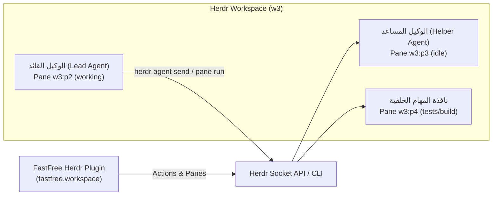

# Herdr Multi-Agent Coordination & Workflow Guide

يوثق هذا الدليل كيفية تفاعل وتنسيق وكلاء الذكاء الاصطناعي (AI Agents) داخل بيئة **Herdr** ومحاكي الطرفيات المتعدد، مع استعراض أوامر الـ Socket والـ CLI واستغلال الإضافات (`plugins`).

---

## 1. ما هو Herdr وكيف يعمل مع الوكلاء؟

Herdr هو منصة لإدارة طرفيات العمل وتنسيق وكلاء الذكاء الاصطناعي (Agent Orchestrator):
- عند تشغيل أي وكيل (مثل Antigravity أو Claude Code) داخل نافذة في Herdr، يتم تمرير متغير البيئة:
  `HERDR_ENV=1`
- يتيح هذا المتغير للوكيل التخاطب مع سحر Herdr والتحكم في النوافذ (Panes) ومراقبة الوكلاء الآخرين وفتح جلسات متوازية دون تشتيت انتباه المستخدم.



---

## 2. أوامر سطر الأوامر الأساسية للوكلاء (Agent CLI Commands)

### 1. استكشاف الوكلاء والنوافذ:
```bash
# استعراض جميع الوكلاء النشطين وحالتهم
herdr agent list

# معرفة حالة مساحة العمل والنافذة الحالية
herdr status
```

### 2. تقسيم النوافذ وتشغيل مهام خلفية:
```bash
# تقسيم النافذة أفقياً أو رأسياً لتشغيل خادم التطوير أو الاختبارات
herdr pane split right --command "flox activate -- pnpm --filter fastfree_ledger dev"

# قراءة مخرجات نافذة أخرى للتحقق من انتهاء مهمة
herdr pane read w3:p4 --lines 50

# الانتظار حتى تطبع نافذة نصاً معيناً (مثل جاهزية الخادم)
herdr pane wait-output w3:p4 --pattern "Local: http://localhost:9000" --timeout 30
```

### 3. إرسال مهام لوكيل شقيق (Sibling Agent):
عندما يكون هناك وكيل شقيق خامل (مثل `helper` في `w3:p3`):
```bash
# إرسال مهمة تفصيلية للوكيل الشقيق
herdr pane send w3:p3 "يرجى فحص التوافقية وتشغيل vue-tsc على حزمة fastfree_sales وكتابة التقرير"
```

---

## 3. إضافة FastFree في Herdr (`fastfree.workspace`)

تم تسجيل إضافة مخصصة للمشروع في:
`Desktop/fastfree/.herdr/plugin/herdr-plugin.toml`

### الإجراءات المتاحة في الإضافة (Plugin Actions):
1. **`ledger-dev`**: تشغيل خادم التطوير لتطبيق `fastfree_ledger`.
2. **`typecheck`**: تشغيل فحص الأنواع (`vue-tsc`) عبر نافذة منبثقة دون تعطيل شاشة العمل.
3. **`lint`**: تشغيل فحص التنسيق والجودة (`lint:check`).
4. **`monorepo-status`**: عرض شامل لحالة الحزم والتطبيقات.

---

## 4. سيناريوهات التعاون المثالية (Collaboration Patterns)

1. **سيناريو التدقيق والبرمجة المتزامنة (Parallel Auditing)**:
   - الوكيل القائد يعدل الكود البرمجي في الحزم.
   - الوكيل المساعد (`helper`) يراقب الأخطاء ويشغل الـ Typecheck باستمرار في نافذة خلفية.
2. **سيناريو الاختبار والبناء الثقيل (Heavy Builds)**:
   - يتم تشغيل بناء صور Hyper-V أو اختبارات Playwright في نافذة منفصلة (`herdr pane split`) لمنع حظر وكيل البرمجة الأساسي.
