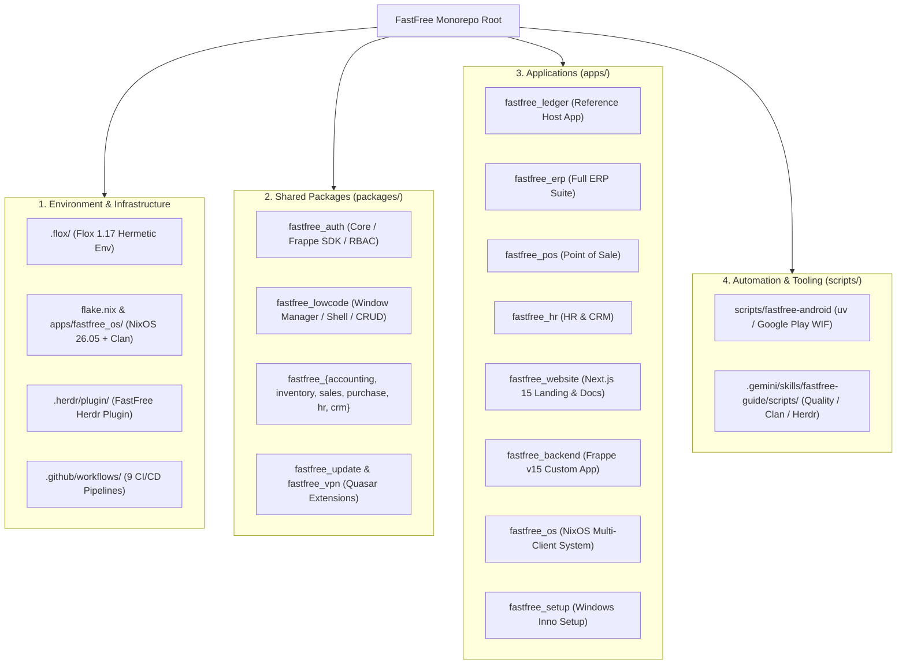

# FastFree Monorepo — الدليل المعماري والتشغيلي الشامل

مرحباً بك في مهارة **FastFree Guide**. تم تصميم هذا الدليل لتمكين أي مطور أو وكيل ذكاء اصطناعي (AI Agent) من فهم وتطوير واختبار ونشر أي جزء من منظومة **FastFree** بكفاءة واحترافية وباتباع المعايير الهندسية المعتمدة للمشروع.

---

## 1. خريطة المونوريبو ونظرة عامة (Monorepo Blueprint)

مشروع **FastFree** هو منصة مؤسسية شاملة (Enterprise ERP & OS Ecosystem) مبنية بنظام الـ Monorepo متعدد التقنيات:



### ملفات التكوين المركزية:
- [`package.json`](file:///home/fastfree/Desktop/fastfree/package.json): محدد مدير الحزم (`pnpm ^11.11.0 / 12.x`) وإعدادات الـ ES Modules.
- [`pnpm-workspace.yaml`](file:///home/fastfree/Desktop/fastfree/pnpm-workspace.yaml): تعريف مساحات العمل لـ `packages/*` و `apps/*`.
- [`.flox/env/manifest.toml`](file:///home/fastfree/Desktop/fastfree/.flox/env/manifest.toml): بيئة التطوير الموحدة والمعزولة.
- [`flake.nix`](file:///home/fastfree/Desktop/fastfree/flake.nix): مدخل الـ Clan الموجه لنظام FastFree OS.
- [`apps/fastfree_os/clan.nix`](file:///home/fastfree/Desktop/fastfree/apps/fastfree_os/clan.nix): سجل أجهزة الأسطول والخدمات الرسمية.
- [`.herdr/plugin/herdr-plugin.toml`](file:///home/fastfree/Desktop/fastfree/.herdr/plugin/herdr-plugin.toml): مانيفست إضافة Herdr لتشغيل الخوادم والفحوصات في نوافذ منفصلة.

---

## 2. جدول الحزم والتطبيقات وحالتها (Modules Status)

| العنصر | المسار | التقنية الرئيسية | الدور والوظيفة |
|---|---|---|---|
| **fastfree-auth** | [`packages/fastfree_auth`](file:///home/fastfree/Desktop/fastfree/packages/fastfree_auth) | TS / Frappe JS SDK / Dexie | النواة المركزية: تسجيل الدخول، الجلسات، الصلاحيات، اتصال Frappe API |
| **fastfree-lowcode** | [`packages/fastfree_lowcode`](file:///home/fastfree/Desktop/fastfree/packages/fastfree_lowcode) | Vue 3 / Quasar Extension | محرك النوافذ المتعددة، الجداول الديناميكية، النماذج، وسجل الترجمة |
| **fastfree-accounting** | [`packages/fastfree_accounting`](file:///home/fastfree/Desktop/fastfree/packages/fastfree_accounting) | Vue 3 / Pinia / TS | شجرة الحسابات، قيود اليومية، سندات الدفع، السنوات المالية، التقارير |
| **fastfree-inventory** | [`packages/fastfree_inventory`](file:///home/fastfree/Desktop/fastfree/packages/fastfree_inventory) | Vue 3 / Pinia / TS | إدارة الأصناف، المستودعات، حركات النقل المخزني والكميات |
| **fastfree-sales** | [`packages/fastfree_sales`](file:///home/fastfree/Desktop/fastfree/packages/fastfree_sales) | Vue 3 / Pinia / TS | العملاء، عروض الأسعار، أوامر البيع، فواتير البيع، سندات التسليم |
| **fastfree-purchase** | [`packages/fastfree_purchase`](file:///home/fastfree/Desktop/fastfree/packages/fastfree_purchase) | Vue 3 / Pinia / TS | الموردون، طلبات الشراء، سندات الاستلام، فواتير الشراء |
| **fastfree-hr** | [`packages/fastfree_hr`](file:///home/fastfree/Desktop/fastfree/packages/fastfree_hr) | Vue 3 / Pinia / TS | الموظفون، الأقسام، الحضور والانصراف، الإجازات، مسيرات الرواتب |
| **fastfree-crm** | [`packages/fastfree_crm`](file:///home/fastfree/Desktop/fastfree/packages/fastfree_crm) | Vue 3 / Pinia / TS | العملاء المحتملون (Leads)، الفرص البيعية، جهات الاتصال، الحملات |
| **fastfree_ledger** | [`apps/fastfree_ledger`](file:///home/fastfree/Desktop/fastfree/apps/fastfree_ledger) | Quasar (Vite) / Capacitor 7 | تطبيق الدفتر والمحاسبة والمخزون المرجعي لفحص الجودة |
| **fastfree_erp** | [`apps/fastfree_erp`](file:///home/fastfree/Desktop/fastfree/apps/fastfree_erp) | Quasar (Vite) / Capacitor 7 | تطبيق ERP الشامل الجامع لكافة حزم الأعمال |
| **fastfree_backend** | [`apps/fastfree_backend`](file:///home/fastfree/Desktop/fastfree/apps/fastfree_backend) | Frappe v15 / Python / MariaDB | خادم التطبيقات الخلفية المشغل لقاعدة البيانات والـ API |
| **fastfree_os** | [`apps/fastfree_os`](file:///home/fastfree/Desktop/fastfree/apps/fastfree_os) | NixOS 26.05 / Clan Multi-Mesh | أسطول الأجهزة وخوادم الإنتاج والشبكات المشفرة |

---

## 3. بيئة العمل المعزولة مع Flox (Hermetic Dev)

يوفر Flox بيئة محكمة تتضمن: Node.js 22، pnpm 12.x/11.x، Python 3.12، Java JDK 21، و Git/gh.
دائماً نفذ الأوامر عبر Flox لضمان العزل التام:
```bash
# تنفيذ أمر فوري عبر Flox
flox activate -d /home/fastfree/Desktop/fastfree -- pnpm --filter fastfree_ledger dev

# أو تشغيل فحص الجودة المجمع
bash .gemini/skills/fastfree-guide/scripts/check-quality.sh apps/fastfree_ledger
```

---

## 4. بنية شبكات Clan 26.05 متعددة الوسائط (Multi-Transport Architecture)

يعتمد أسطول FastFree OS على نموذج الأولويات والتبديل التلقائي (Transport Priority & Failover):
1. **`internet` (الأولوية 1)**: وصول مباشر عبر الإنترنت العام لـ VPS (`fastfree.cloud`).
2. **`zerotier` (الأولوية 2)**: شبكة L2/L3 الذكية المخترقة للـ NAT مع Controller ذاتي الاستضافة وميزة التعرف التلقائي على الـ IP.
3. **`wireguard` (الأولوية 3)**: شبكة النواة المشفرة IPv6 ULA على منفذ `51821`.
4. **`garage` (خدمة التخزين الموزع)**: مخزن S3 ذاتي التوزيع ومستقل بين الأجهزة.
5. **`borgbackup`**: نسخ احتياطي دوري مشفر ومحلي ومركزي.

> كود كامل جاهز: راجع [`examples/clan-multi-transport.nix`](./references/examples/clan-multi-transport.nix)
> توثيق تفصيلي: راجع [`references/flox-nix-clan-guide.md`](./references/flox-nix-clan-guide.md)

---

## 5. تنسيق وكلاء الذكاء الاصطناعي عبر Herdr (Multi-Agent Orchestration)

عند تشغيل الوكلاء داخل Herdr (`HERDR_ENV=1`):
- يمكنك تفويض المهام لوكيل شقيق (مثل `helper` في النافذة `w3:p3`).
- تشغيل المهام الثقيلة (بناء صور NixOS، أو فحص الأنواع) في نوافذ خلفية منبثقة دون حظر المحادثة.

```bash
# استعراض الوكلاء الشقيقين
bash scripts/herdr-task.sh list

# تقسيم نافذة وتشغيل سيرفر التطوير
bash scripts/herdr-task.sh split-run "flox activate -- pnpm --filter fastfree_ledger dev"
```
> طالع الدليل التفصيلي: [`references/herdr-agent-coordination.md`](./references/herdr-agent-coordination.md)

---

## 6. قواعد الجودة الصارمة (Zero Tolerance Invariants)

1. **الأنواع الصارمة أولاً (Types First)**:
   - يمنع استخدام `Record<string, unknown>`؛ استخدم `Partial<DocType>`.
   - التزم بـ `exactOptionalPropertyTypes`.
2. **طبقة الخدمات حصراً (Service Layer Only)**:
   - لا تضع طلبات HTTP مباشرة في مكونات `.vue`؛ استخدم دائماً `*.service.ts` من `fastfree-auth`.
3. **واجهات المستخدم وإمكانية الوصول**:
   - خصائص RTL المنطقية: `inset-inline-start/end`، و `padding-inline`.
   - إضافة `aria-label` لكل زر تفاعلي.
   - النماذج تدعم `@submit.prevent`.
4. **الترجمة المتزامنة**:
   - كل مفتاح جديد يضاف إلى `locales/en.ts` و `locales/ar.ts` معاً.
5. **نظافة الكود**:
   - ممنوع تماماً ترك أي `console.log` أو `console.error` في كود الإنتاج.

---

## 7. الأدوات البرمجية المساعدة (Executable Scripts)

توفر هذه المهارة سكربتات تشغيلية جاهزة داخل مجلد `scripts/`:
1. [`scripts/check-quality.sh`](./scripts/check-quality.sh): يشغل `vue-tsc` و `eslint` داخل Flox.
2. [`scripts/clan-ops.sh`](./scripts/clan-ops.sh): يفحص بناء ومخزون Clan 26.05 ويدير الأسرار والتحديثات.
3. [`scripts/herdr-task.sh`](./scripts/herdr-task.sh): يدير تقسيم النوافذ والتنسيق مع الوكلاء الشقيقين داخل Herdr.
4. [`scripts/sync-mcp.sh`](./scripts/sync-mcp.sh): مزامنة وتوحيد خوادم MCP العشرة بين `opencode.json` وكافة الوكلاء.

---

## 8. مكتبة الأمثلة البرمجية (Code Examples)

1. [`examples/clan-multi-transport.nix`](./references/examples/clan-multi-transport.nix): تكوين Clan متكامل يجمع بين `internet` و `zerotier` و `wireguard` و `garage` و `borgbackup`.
2. [`examples/lowcode-screen.vue`](./references/examples/lowcode-screen.vue): شاشة Quasar/Vue 3 متوافقة 100% مع قواعد المعمارية والـ RTL والـ a11y.
3. [`examples/domain-service.ts`](./references/examples/domain-service.ts): خدمة Frappe SDK كاملة وآمنة الأنواع.

---

## 9. المراجع المتخصصة (Reference Library)

1. [**دليل المعمارية التفصيلي**](./references/architecture-deep-dive.md): شرح الطبقات الأربع وإعدادات Vite والـ TS.
2. [**دليل Flox و NixOS و Clan 26.05**](./references/flox-nix-clan-guide.md): شرح شبكات Clan المتعددة والخدمات الرسمية.
3. [**دليل تنسيق الوكلاء عبر Herdr**](./references/herdr-agent-coordination.md): كيفية التحكم بالنوافذ والوكلاء الشقيقين والـ Plugins.
4. [**دليل أندرويد و Google Play**](./references/android-play-guide.md): بناء ونشر تطبيقات المحمول عبر WIF و uv.
5. [**دليل خادم Frappe الخلفي**](./references/backend-frappe-guide.md): شبكة الحاويات MariaDB و Frappe API.
