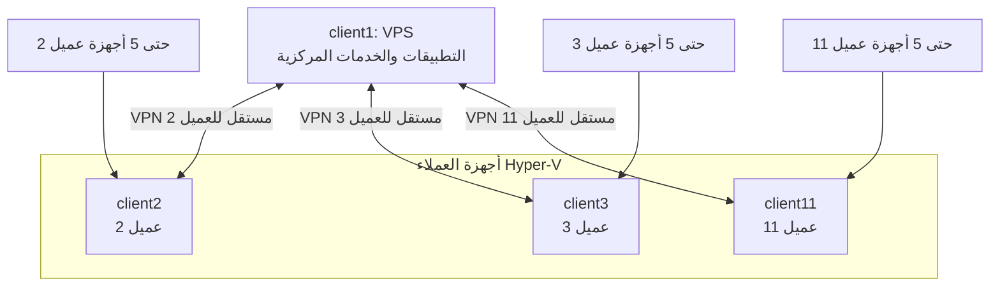

# تقييم FastFree OS وخطة تنظيم العملاء

> **الغرض:** تقييم إعداد الأسطول الحالي مقابل Clan 26.05، ثم تقديم خطة تنفيذ قابلة للمراجعة. هذا المستند مقترح مبني على فحص ساكن للكود وتوثيق Clan الرسمي؛ لم تُعدّل إعدادات الأجهزة أو الشبكات أو النشر أثناء إعداد التقييم.

## الخلاصة ببساطة

المطلوب النهائي واضح: **client1 هو VPS**، والعملاء **client2 إلى client11 أجهزة Hyper‑V**. خادم VPS يشغّل كل تطبيقات FastFree، وكل عميل Hyper‑V يشغّل مجموعة تطبيقات الأعمال المحددة. يجب أن تكون شبكة كل عميل معزولة عن العملاء الآخرين، مع اتصال آمن بين أجهزته وخادم VPS، وبحد أقصى خمسة أجهزة مستخدم لكل عميل.

الإعداد الحالي لا يطابق هذا الهدف بعد: أدوار VPS وHyper‑V موزعة على أجهزة أخرى، وبعض ملفات الأجهزة فيها مراجع غير موجودة أو خيارات غير معرّفة، وشبكات WireGuard فيها تعارض محتمل للمنافذ وتكرار أدوار. لذلك التوصية هي **إصلاح الأساس ثم نقل الأدوار والتطبيقات والشبكات على مراحل**، وليس تبديل اسم الجهاز في ملف واحد.

## ما يعنيه `base` و`shell`

- **`base`**: إعدادات نظام FastFree الأساسية، مثل الإقلاع والشبكة والنظام واللغة والتكاملات. هو أساس كل جهاز، وليس تطبيقًا للعميل؛ يجب أن يكون مفعّلًا على VPS وكل أجهزة Hyper‑V.
- **`shell`**: أدوات طرفية ومطور مثل Zsh وNode وpnpm وأدوات البحث. لا يفعّل SSH. أوصي بإبقائه اختياريًا وإيقافه على أجهزة العملاء ما لم تكن هناك حاجة تشغيلية واضحة.
- **SSH**: يدار منفصلًا عبر خدمة Clan الرسمية `sshd`، مع مفاتيح عامة وحسابات مناسبة، لا عبر `shell` أو كلمات مرور ثابتة.

## التوزيع المستهدف المقترح

| الأجهزة | الدور | النظام الأساسي | خدمات التطبيقات المقترحة |
|---|---|---|---|
| `client1` | VPS مركزي | `base`، وأدوات التشغيل التي يحتاجها المسؤول فقط | كل تطبيقات FastFree: Panel وLedger وERP وHR وPOS وWebsite، مع Backend وMariaDB والخدمات التشغيلية المطلوبة مثل Caddy. DbGate وCockpit أدوات إدارة اختيارية وليستا شرطًا لتشغيل المنتجات. |
| `client2` إلى `client11` | Hyper‑V لكل عميل | `base`؛ وملف/تعريف Hyper‑V مشترك | Ledger لحزم المحاسبة والمبيعات والمخزون، وERP وHR/CRM وPOS، مع Backend وMariaDB عند اعتماد قاعدة بيانات محلية لكل عميل، وCaddy لخدمة واجهات الويب. |

**مهم:** أسماء الخيارات الموجودة حاليًا لا تطابق أسماء كل الحزم. لا توجد خيارات مستقلة مثبتة باسم `fastfree_accounting` أو `fastfree_sales` أو `fastfree_inventory` أو `fastfree_crm`. الموجود هو تجميعات مثل `fastfree_ledger` و`fastfree_hr`، لذلك يجب التحقق من محتوى كل تجميعة قبل اعتماد مصفوفة التفعيل. لا ينبغي كتابة أسماء خيارات جديدة في ملفات العملاء قبل تعريفها في `options.nix`.

توصيتي أن تكون Website وPanel وDbGate وCockpit وPaseo وأدوات المطور على VPS فقط بحسب الحاجة. لا أضع Paseo أو Website أو DbGate أو Cockpit على كل Hyper‑V افتراضيًا. كما أن `base` مطلوب على الجميع، بينما `shell` ليس مطلوبًا لتشغيل تطبيقات العميل.

## نتائج الفحص الحالية

### 1. توزيع الأدوار مخالف للهدف

في الملفات الحالية، `client1` معرّف كـ Hyper‑V، و`client2` كـ VPS، و`client3` كجهاز محلي. كذلك ملفات البناء وCI ما زالت تتعامل مع `client1` كصورة Hyper‑V و`client2` كـ VPS. نقل الدور يحتاج تحديث الملفات وسير البناء والنشر والتشخيص معًا.

### 2. ملفات العملاء ليست متسقة

- `client2` يستورد مسارات WireGuard داخل مجلد فرعي غير موجود؛ الملفات الحالية موجودة مباشرة في `modules/`.
- ملفات `client5` إلى `client11` تحتوي صياغة Nix غير صالحة في مرجع حزمة (كانت حزمة Herdr — مُزالة الآن من المشروع، التنسيق يعتمد Paseo عبر ملف docs/paseo-cli.md).
- ملف `client4` لا يستورد الخيارات والوحدات المشتركة، ويستخدم خيارات تطبيقات غير معرفة، ويضع `tags` ضمن إعداد NixOS بدل سجل Clan.
- توجد كلمات مرور root ثابتة والسماح بتسجيل دخول SSH بكلمة مرور في إعدادات حالية؛ ينبغي إزالتها واستخدام إدارة حسابات ومفاتيح SSH المناسبة.
- ملفات عدة عملاء تكرر قوائم استيراد طويلة ومتقاربة. الأفضل تعريف ملفات أدوار مشتركة ثم جعل ملف كل جهاز يحدد العتاد والدور فقط.

### 3. سجل Clan والخدمات الرسمية

Clan يسجل مجلدات الأجهزة تلقائيًا، لذلك وجود ملفات `client4`–`client11` يجعلها قابلة للاكتشاف. لكن سجل `inventory.machines` الصريح حاليًا لا يحتوي بيانات/وسوم كاملة لكل الأسطول. وفق توثيق Clan 26.05، بيانات الجهاز مثل الوسوم ومعلومات النشر مكانها `inventory.machines`، وعضوية الخدمات وأدوارها وإعداداتها مكانها `inventory.instances`.

استخدام `inventory.instances` لخدمات Clan الرسمية مثل `sshd` و`users` و`wireguard` يتماشى عمومًا مع النموذج الرسمي. أما `fastfree.apps.*` فهي خيارات NixOS خاصة بالمشروع، وليست حقولًا رسمية في Clan؛ هذا مقبول بشرط أن تكون معرفة مركزيًا ومستخدمة باتساق.

### 4. شبكة VPN تحتاج إعادة تصميم قبل النشر

- التكوين الحالي يجعل `client2` مركز الشبكة، بينما المطلوب أن يكون `client1` هو VPS المركزي.
- هناك حالات يظهر فيها الجهاز نفسه بدور controller وpeer في مثيل واحد؛ يجب مراجعة الأدوار وحذف أي عضوية ذاتية غير لازمة.
- عدة مثيلات WireGuard تستخدم منفذ الاستماع نفسه `51821` على المضيف ذاته. توثيق Clan ينبه إلى أن المثيلات المتعددة على الجهاز تحتاج منافذ مختلفة.
- إعدادات الشبكة الحالية لا تضمن حد خمسة أجهزة مستخدم لكل عميل، ولا تثبت عزل عميل عن الآخر.
- ربط كل عملاء المواقع في شبكة واحدة كاملة قد يتيح اتصالًا بينهم. الأنسب مثيل شبكة منفصل لكل عميل، بحيث يضم VPS والـ Hyper‑V التابع لذلك العميل فقط، إضافة إلى أجهزته الخمسة.
- أجهزة الهاتف/اللابتوب الخارجية ليست أجهزة Clan مُدارة تلقائيًا كأعضاء أجهزة؛ يلزم تصميم طريقة آمنة لإضافة أقرانها وإصدار ملفات الاتصال وQR دون تسريب المفاتيح الخاصة إلى Git أو `/nix/store`.

**التوصية:** شبكة مستقلة لكل عميل: `client1` + جهاز العميل المقابل + حتى خمسة أجهزة مستخدم. يكون `client1` نقطة الوصول العامة، لأن أجهزة Hyper‑V لدى العملاء قد تكون خلف NAT. خصص منفذًا فريدًا لكل مثيل على VPS، ولا تستخدم ZeroTier. قبل اعتماد التصميم، أثبت أن إضافة أقران الأجهزة الخارجية تتكامل فعلًا مع إعداد Clan الرسمي ولا تتسبب بتعارض مع الواجهات المُدارة.

### 5. مخاطر الأسرار والبناء

يوجد إعداد كلمة مرور ثابتة لتشفير VHDX ضمن إعدادات Nix. الأسرار لا ينبغي أن تدخل Git أو مخرجات `/nix/store`. يجب نقل التشفير إلى خطوة خارج بناء Nix، تستخدم سر CI محميًا، أو اعتماد آلية أسرار مشفرة معتمدة في المشروع.

### 6. قيود التحقق

هذه مراجعة ساكنة ومقارنة مع وثائق Clan الرسمية. أمر `nix` وأداة `clan` غير متاحين في بيئة الفحص الحالية، لذلك لم يمكن تأكيد نجاح تقييم Flake أو بناء صور الأجهزة. اعتبر العوائق المذكورة مؤشرات من الكود تحتاج تأكيدًا ببوابة التحقق أدناه قبل النشر.

## تقييم مختصر

| الجانب | التقييم الحالي | ما يلزم للوصول للهدف |
|---|---|---|
| أسلوب Clan العام | جيد جزئيًا | استكمال بيانات كل الأجهزة في inventory ومراجعة عضوية الخدمات. |
| توزيع VPS وHyper‑V | غير مطابق | نقل الدور إلى `client1` وتحديث كل ملفات CI والبناء والنشر. |
| تنظيم ملفات العملاء | يحتاج إعادة تنظيم | وحدات مشتركة لـ base وVPS وHyper‑V وملفات جهاز صغيرة. |
| خيارات التطبيقات | غير محسوم بالكامل | تثبيت خريطة التجميعات الموجودة والتحقق من تطبيقاتها قبل تفعيلها. |
| VPN والعزل | يحتاج إعادة تصميم | شبكة مستقلة لكل عميل، منافذ فريدة، وآلية أجهزة خارجية محدودة وآمنة. |
| الأمان | توجد نقاط حرجة | حذف كلمات المرور الثابتة، SSH بالمفاتيح، وإخراج سر VHDX من Nix. |
| قابلية النشر | مخاطرة مرتفعة قبل الإصلاح | لا تنشر قبل نجاح التقييم والبناء وتجربة شبكة عميل معزولة. |

**الحكم:** الأساس قابل للتطوير لأن المشروع يستخدم Clan ويفصل بين إعدادات الأجهزة ومثيلات الخدمات، لكن الحالة الحالية ليست جاهزة لنقل الإنتاج إلى الهدف المطلوب. أكبر مخاطرها الآن هي أخطاء التقييم، اختلاف ملفات العملاء، وتكوين الشبكة والأسرار.

## خطة التنفيذ المقترحة

### المرحلة 1: تثبيت مصفوفة الأجهزة والتطبيقات

اعتماد `client1 = VPS` و`client2..client11 = Hyper‑V`. توثيق التطبيقات المطلوبة لكل دور، ثم مطابقة كل تطبيق مع خيار NixOS موجود فعليًا ومراجعة محتويات `fastfree_ledger` و`fastfree_hr` و`fastfree_erp` و`fastfree_pos`. لا تضف مفاتيح تطبيقات افتراضية غير معرفة.

### المرحلة 2: إزالة موانع التقييم والأمان

تصحيح الاستيرادات المكسورة والصياغة غير الصالحة وخيارات التطبيقات غير المعرفة. إزالة كلمات المرور الثابتة وتسجيل SSH بكلمة مرور، ونقل سر تشفير VHDX إلى سر CI خارج مشتقات Nix. لا تنتقل قبل أن تصبح ملفات الأجهزة قابلة للتقييم.

### المرحلة 3: إنشاء أدوار مشتركة واضحة

إنشاء وحدة مشتركة لـ `base` ووحدة دور VPS ووحدة دور Hyper‑V. كل جهاز يستورد الدور المناسب ويحتفظ بإعداد العتاد الخاص به؛ لا تكرر قائمة طويلة من الوحدات داخل 11 ملفًا. اجعل `shell` خيارًا تشغيليًا صريحًا وليس جزءًا تلقائيًا من تطبيقات العملاء.

### المرحلة 4: ضبط Clan inventory والخدمات

إضافة بيانات `client1` إلى `client11` ووسوم الأدوار في `inventory.machines`. تعريف عضويات `sshd` و`users` وWireGuard في `inventory.instances` وفق خدمة Clan الرسمية. إزالة `tags` من وحدات NixOS.

### المرحلة 5: نقل التطبيقات

تفعيل كامل الخيارات المدعومة على VPS. تفعيل تجميعات تطبيقات الأعمال المطلوبة على كل Hyper‑V. اجعل MariaDB وBackend محليين لكل عميل إذا كان هذا شرط العزل الذي نعتمده، مع منع واجهات الإدارة العامة افتراضيًا. فعّل Caddy على أجهزة التطبيقات التي تحتاج تقديم واجهات الويب.

### المرحلة 6: بناء VPN معزول

إعادة تعريف كل شبكة عميل بمثيل مستقل يضم VPS وعميل Hyper‑V التابع له فقط. تخصيص منفذ استماع فريد لكل مثيل على VPS. إضافة مسار موثق لإدارة خمسة أجهزة مستخدم كحد أقصى لكل عميل، مع حفظ المفاتيح الخاصة على أجهزة المستخدم فقط. لا تستخدم سكربتات Python لهذا المسار، ولا تفعّل ZeroTier.

### المرحلة 7: توحيد Flake وCI والتوثيق

تحديث تعريفات صور الأجهزة وملفات GitHub Actions وأوامر التشخيص والنشر لتعكس `client1` كـ VPS و`client2..11` كـ Hyper‑V. حدّث صفحات التوثيق بعد تثبيت التكوين الحقيقي؛ لا تجعل المستندات تصف تصميمًا لم يُبنَ أو يُفحص بعد.

### المرحلة 8: التحقق ثم الانتقال الآمن

1. تثبيت أدوات Nix وClan المتوافقة مع المشروع.
2. فحص صياغة Nix وتقييم Flake وقائمة أجهزة Clan والخدمات.
3. بناء صورة Hyper‑V تجريبية وتهيئة `client1` كتكوين VPS دون استبدال الخادم العامل.
4. اختبار عميل واحد: وصول أجهزته إلى VPS وخدماته، وفشل الوصول إلى عميل آخر، والتحقق من حد خمسة أجهزة.
5. بناء صور بقية الأجهزة بعد نجاح التجربة.
6. أخذ نسخة احتياطية ووضع خطة رجوع قبل نقل خدمة VPS الإنتاجية.

النشر أو تغيير VPS الإنتاجي هو آخر خطوة بعد نجاح المراحل السابقة؛ هذا التقييم نفسه لم ينفذ أي نشر.

## مراجع Clan الرسمية، إصدار 26.05

- [مقدمة سجل الأجهزة والمثيلات](https://clan.lol/docs/26.05/guides/inventory/intro-to-inventory) — الفرق بين بيانات الأجهزة وعضوية الخدمات.
- [Autoincludes للأجهزة](https://clan.lol/docs/26.05/guides/inventory/autoincludes) — اكتشاف مجلدات `machines/<name>` تلقائيًا.
- [الشبكات في Clan](https://clan.lol/docs/26.05/guides/networking/networking) — نظرة Clan الرسمية على الشبكات.
- [خدمة WireGuard الرسمية](https://clan.lol/docs/26.05/services/official/wireguard) — الأدوار والمفاتيح والمنافذ عند تعدد المثيلات.
- [خدمة SSHD الرسمية](https://clan.lol/docs/26.05/services/official/sshd) — أدوار خادم/عميل SSH وإدارة المفاتيح.
- [خدمة المستخدمين الرسمية](https://clan.lol/docs/26.05/services/official/users) — إدارة المستخدمين والمجموعات وكلمات المرور المولدة.
- [خدمة الحزم الرسمية](https://clan.lol/docs/26.05/services/official/packages) — تثبيت الحزم بحسب الدور.
- [ملاحظات إصدار Clan 26.05](https://clan.lol/docs/26.05/releases/26-05) — تغييرات الإصدار وأنماط التحديث.

## حدود هذا المستند

المستند خطة تقييم وتنفيذ مقترحة، وليس تغييرًا في تكوين الأجهزة. لم تُشغّل اختبارات أو عمليات بناء لأن أدوات Nix/Clan غير متاحة في بيئة الفحص، ولم يتغير أي ملف من إعدادات العملاء أو CI أو VPN.

---

## توسعة المراجعة: نطاق وثائق Clan 26.05 الذي فُحص

هذه النسخة لا تعتمد على WireGuard فقط. روجعت أقسام التوثيق الرسمية التالية وربطت بالخطة: البداية والتثبيت، Inventory وAutoincludes، الخدمات والأدوار والوسوم والمثيلات المتعددة، Vars وSOPS وage، النسخ الاحتياطي والاستعادة، الشبكات وطرق الوصول والنشر، الترحيل وإعادة تسمية الأجهزة، البناء البعيد، SSH agent forwarding، تشفير الأقراص، SSL الداخلي وExports، خيارات Clan و`clan.core` وCLI، ومجموعة الخدمات الرسمية.

الخدمات الرسمية التي لها أثر مباشر هنا هي: `internet`، `sshd`، `users`، `wireguard`، `borgbackup`، `packages`، `emergency-access`، `trusted-nix-caches`، وخدمات PKI/DNS الداخلية. خدمات مثل Garage وmonitoring وSyncthing قُيّمت كخيارات لاحقة وليست شرطًا لتصحيح الأسطول.

لا يعني ذلك نسخ كل ميزة في Clan إلى FastFree. الخطة تختار فقط ما يحل حاجة فعلية: إدارة الأجهزة، الأسرار، الوصول، النسخ الاحتياطي، عزل الشبكة، وبناء الصور والنشر.

## التصميم النهائي المقترح

كل عميل يحصل على مثيل WireGuard مستقل يجمع `client1` وجهازه Hyper-V وأجهزته المصرح بها فقط. لا تنشأ طرق مرور بين شبكات العملاء. يجب أن يملك كل مثيل منفذ UDP مختلفًا على VPS. لا تتضمن ملفات Git أو `/nix/store` مفاتيح WireGuard الخاصة لأجهزة المستخدم.

## ما سيُنظف تحديدًا

| المجال | الحالة المكتشفة | الإجراء المقترح |
|---|---|---|
| ملفات العملاء | قوائم imports طويلة ومكررة، وملفات مختلفة بلا نمط واحد | إنشاء `profiles/base.nix` و`profiles/vps.nix` و`profiles/hyperv.nix`؛ ملف الجهاز يصبح للعتاد والاسم والفروق الخاصة فقط. |
| دور الأجهزة | `client1` Hyper-V و`client2` VPS حاليًا | نقل الدور بصورة متزامنة في الملفات وInventory وFlake وCI والتشخيص والتوثيق. لا نعيد تسمية الجهاز إلا عند الضرورة لأن الاسم مرتبط بـVars والخدمات. |
| Inventory | بيانات صريحة لثلاثة أجهزة فقط ووسوم في ملفات NixOS | جعل `client1..client11` سجلًا كاملًا في `inventory.machines`، مع وسوم مثل `vps` و`hyperv` و`customer` و`client-2`. |
| الخدمات العامة | إعداد SSH والمستخدمين متناثر في ملفات الأجهزة | نقل SSH والمستخدمين والحزم والنسخ الاحتياطي إلى `inventory.instances` باستخدام tags والأدوار. |
| التطبيقات | تفعيل Paseo وWebsite وDbGate وshell على عملاء Hyper-V، وخيارات تطبيقات غير معرفة في `client4` | مصفوفة تطبيقات واحدة بحسب الدور؛ VPS كامل، وHyper-V تطبيقات الأعمال فقط؛ إصلاح/حذف الخيارات غير المعرفة. |
| WireGuard | `client2` controller، عضوية ذاتية، منافذ متكررة، وحدات متداخلة غير مستخدمة | `client1` controller، مثيل معزول لكل عميل، منفذ فريد لكل مثيل، وإزالة الوحدات القديمة بعد إثبات عدم وجود مراجع لها. |
| أسرار SSH وVHDX | كلمات مرور root ثابتة وكلمة مرور أرشيف VHDX ضمن Nix | حذف القيم الثابتة، استخدام `users` و`sshd` وClan Vars، وتنفيذ تشفير artifact خارج Nix عبر سر CI. |
| النسخ الاحتياطي | لا توجد خطة استعادة مؤهلة لكل MariaDB/Backend | تعريف state للبيانات، BorgBackup مشفر إلى وجهة مستقلة، hooks لسلامة البيانات، واختبار استعادة فعلي. |
| الشبكة القديمة | أسماء ومضيفون ثابتون قديمون في `modules/networking.nix` | استبدالها بمعلومات Inventory وخدمات Clan، وإزالة أسماء أو عناوين لم تعد جزءًا من التصميم. |
| Python لإدارة VPN | سكربتات `scripts/wg-*.py` موجودة | حذف أو استبدال مسار إدارة VPN بالـNix وClan بعد نقل وظيفته واختبار البديل. لا يمتد هذا إلى Python الذي يحتاجه Backend نفسه. |
| وحدات VPN ولوحة التحكم | وحدات غير مستوردة ومسار يحقن كودًا في Panel أثناء التشغيل | تحديد مالك واحد لمسار إدارة الأجهزة؛ حذف الوحدات غير المرجعية بعد تقييم ناجح، وتحويل أي تكامل ضروري إلى كود منتج مُراجع بدل حقن runtime. |
| CI وFlake | VHDX موجّه لـ`client1` القديم وعمليات VPS لـ`client2` | بناء package عام لـHyper-V، اختيار العميل كمدخل، وتحويل workflow النشر والتشخيص إلى `client1`. |
| التوثيق | README والمخرجات المحفوظة تصف أسطولًا قديمًا | تصنيفها إلى مصدر حقيقة أو أرشيف، ثم إعادة توليد المخرجات من التكوين الناجح. |

## مصفوفة ملكية الإعدادات

| النوع | مكانه الصحيح |
|---|---|
| اسم الجهاز، الوسوم، وجهة النشر | `inventory.machines` في `clan.nix` |
| عضوية SSH والمستخدمين والـVPN والنسخ الاحتياطي والحزم | `inventory.instances` في `clan.nix` |
| مكونات FastFree المحلية وتكوين NixOS المشترك | ملفات profiles ووحدات `modules/` |
| عتاد Hyper-V أو VPS والاختلافات الضرورية | `machines/<name>/hardware-configuration.nix` وملف الجهاز المختصر |
| كلمات المرور والمفاتيح ومعلومات الاتصال السرية | Clan Vars/age أو أسرار CI، وليس ملفات Nix أو Git |
| صور Hyper-V وعمليات النشر | `flake.nix` وملفات CI بعد توحيدهما مع الـInventory |

## خطة تنفيذ تنظيف كاملة

### 0. جرد وحماية الحالة الحالية

إنشاء قائمة بالملفات المتغيرة وغير المتتبعة وتصنيفها: يبقى، يُدمج، يُؤرشف، أو يُحذف. لا يحذف أي ملف قبل معرفة ما إذا كان مستخدمًا من Workflow أو وثيقة أو خادم قائم. أخذ نسخة احتياطية من VPS وقواعد MariaDB وأسرار Vars قبل أي تغيير بنيوي.

### 1. جعل التكوين صالحًا وآمنًا

إصلاح مسارات الاستيراد غير الموجودة، وصياغة Nix المكسورة، وخيارات التطبيقات غير المعرفة. حذف كلمات مرور root الثابتة وتسجيل الدخول بكلمة مرور. إزالة كلمة مرور VHDX من اشتقاق Nix. نجاح تقييم Nix لكل جهاز هو شرط للانتقال للمرحلة التالية.

### 2. بناء الهيكل الموحد

استخراج ملفات profiles المشتركة. ملف VPS يفعّل كل التطبيقات المطلوبة وCaddy وBackend وMariaDB. ملف Hyper-V يفعّل تطبيقات الأعمال المعتمدة فقط. `base` إلزامي للجميع؛ `shell` وPaseo وأدوات الإدارة تُحصر في VPS أو جهاز الإدارة.

### 3. إعادة بناء Inventory والخدمات

إدخال كل العملاء في `inventory.machines` مع وسوم ثابتة. تعريف `internet` لـ`client1` فقط، و`sshd` و`users` بحسب tags، و`packages` لتوزيع أدوات المسؤولين بلا تكرار. لا يُنقل الاختلاف بين VPS وHyper-V إلى NixOS specialisations؛ هذه الاختلافات أدوار ثابتة وليست تبديلات وقت تشغيل.

### 4. الأسرار والوصول الطارئ

توليد Vars لكل جهاز قبل نشر خدمة تحتاجها. حفظ مفتاح age في موضع استرداد موثق ومؤمّن. إعداد حساب مسؤول غير root ومفاتيح SSH، ثم اختبار الوصول قبل إغلاق الوصول القديم. إضافة emergency access إلى VPS فقط إذا تم توثيق مكان حفظه واختبار الاسترداد.

### 5. بيانات العملاء والنسخ الاحتياطي

تحديد ما يبقى محليًا على كل Hyper-V وما يبقى مركزيًا على VPS. إضافة state لمجلدات MariaDB وBackend والملفات الدائمة. إعداد BorgBackup مشفر إلى وجهة مستقلة، وتنفيذ تجربة استعادة قاعدة بيانات وملف عميل قبل اعتبار النسخ الاحتياطي مكتملًا.

### 6. شبكة VPN والعزل

إزالة المثال القديم والشبكات الذاتية والمنافذ المتصادمة. بناء مثيل VPN تجريبي للعميل 2 أولًا: `client1` controller، `client2` peer، وحتى خمسة أجهزة خارجية بمفاتيح عامة فقط. فحص أن أجهزة العميل 2 تصل للخدمات المصرح بها ولا تصل إلى client3. بعد نجاح الاختبار، تكرار النموذج للعملاء 3–11 بمنافذ ومعرّفات مستقلة.

### 7. تنظيف الوحدات والسكربتات

بعد نجاح البديل، حذف سكربتات Python الخاصة بتوليد WireGuard ووحدات VPN غير المستوردة أو دمج الوحدة الوحيدة المطلوبة. إزالة حقن كود لوحة التحكم وقت التشغيل أو تحويله إلى مصدر TypeScript دائم ضمن التطبيق مع مراجعة صلاحياته. مراجعة `opencode.json` فقط بالنسبة لاحتياج إدارة VPN؛ لا تزال Python مطلوبة لتشغيل FastFree Backend.

### 8. توحيد البناء والتوثيق والنشر

تحديث `flake.nix` ليبني صور Hyper-V للعملاء 2–11 بصورة قابلة للاختيار، وتحديث Workflows النشر والتشخيص لتشير إلى `client1`. تحديث README وصفحات التصميم والمخرجات المولدة بعد نجاح البناء. نقل المخرجات القديمة إلى أرشيف مؤرخ أو إعادة توليدها، حتى لا تكون مصدر تضليل.

### 9. بوابة قبول قبل التعميم

1. تقييم كل NixOS configuration و`clan` inventory بدون أخطاء.
2. توليد Vars ثم فحص عدم وجود أسرار نصية في Git أو `/nix/store`.
3. بناء VPS تجريبي وصورة Hyper-V تجريبية.
4. اختبار SSH بالمفاتيح، Backend وMariaDB وCaddy والتطبيقات المفعلة.
5. اختبار VPN وعزل عميلين على الأقل وحد خمسة أجهزة.
6. إنشاء نسخة Borg واستعادتها في بيئة تجريبية.
7. نشر client1 بعد خطة رجوع مؤكدة، ثم client2 كعميل تجريبي، ثم بقية العملاء دفعات.

## مراجع إضافية من Clan 26.05

- [مقدمة الخدمات والأدوار والوسوم](https://clan.lol/docs/26.05/guides/services/intro-to-services-revised)
- [الترحيل إلى خدمات Inventory](https://clan.lol/docs/26.05/guides/migrations/migrate-inventory-services)
- [إعادة تسمية جهاز Clan](https://clan.lol/docs/26.05/guides/migrations/how-to-rename-a-machine)
- [Vars](https://clan.lol/docs/26.05/guides/vars/intro-to-vars) و[age backend](https://clan.lol/docs/26.05/guides/vars/age/age-backend)
- [النسخ الاحتياطي](https://clan.lol/docs/26.05/guides/backups/intro-to-backups) و[النسخ المتقدم](https://clan.lol/docs/26.05/guides/backups/backup-advanced)
- [خدمة BorgBackup](https://clan.lol/docs/26.05/services/official/borgbackup)
- [خدمة Internet](https://clan.lol/docs/26.05/services/official/internet)، [Packages](https://clan.lol/docs/26.05/services/official/packages)، و[Emergency Access](https://clan.lol/docs/26.05/services/official/emergency-access)
- [الخدمات الداخلية SSL](https://clan.lol/docs/26.05/guides/internal-ssl-services) و[Exports](https://clan.lol/docs/26.05/guides/services/exports)
- [Build Host](https://clan.lol/docs/26.05/guides/build-host)، [NixOS rebuild](https://clan.lol/docs/26.05/guides/nixos-rebuild)، و[Specialisations](https://clan.lol/docs/26.05/guides/specialisations)
